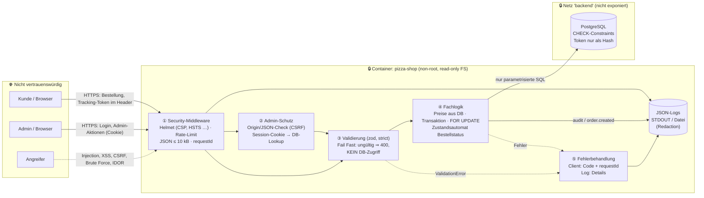

# Datenfluss & Vertrauensgrenzen

## Überblick

**Vertrauensgrenzen**
1. **Internet → App:** Alles aus dem Request (Body, Query, Pfad, Header, Cookies) ist unvertrauenswürdig und wird in ③ gegen eine Allowlist geprüft.
2. **App → Datenbank:** Nur parametrisierte Queries; Spaltennamen kommen nie aus Eingaben. Die DB erzwingt zusätzlich Invarianten (Bestand ≥ 0, Preis > 0, gültige Status).
3. **App → Log:** Personenbezogene Daten und Geheimnisse werden nicht oder nur geschwärzt geloggt; Steuerzeichen werden schon bei der Validierung abgelehnt (Log-Injection).
4. **Server → Browser:** Ausgabe nur als JSON; das Frontend fügt Daten ausschließlich per `textContent` ein, die CSP verbietet Inline-Skripte.

## Schutzbedürftige Datenflüsse

| # | Fluss | Daten | Eingangsprüfung | Senke | Schutz |
|---|---|---|---|---|---|
| F1 | Kunde → `POST /api/orders` → `orders`, `order_items`, `products.stock` | Name, Adresse, Telefon, Produkt-IDs, Mengen | `createOrderBody` (strict, Längen, Regex, Menge 1–20, Duplikate) | Postgres (Transaktion) | Preise nur aus DB (keine Preismanipulation), `SELECT … FOR UPDATE` (kein Überverkauf), atomar (alles oder nichts) |
| F2 | Server → Kunde: Tracking-Token | 256-Bit-Zufallstoken | – | Antwort (einmalig) | Nur SHA-256-Hash gespeichert |
| F3 | Kunde → `GET /api/orders/:id` | Order-UUID, Token (Header) | `uuidParam`, `orderTokenHeader` | Postgres | Timing-sicherer Hash-Vergleich, gleiche 404 für „falsches Token“ und „existiert nicht“ (IDOR), keine Personendaten in der Antwort |
| F4 | Admin → `POST /api/admin/login` | Benutzername, Passwort | `loginBody` | Postgres `admin_users` | scrypt-Hash, Dummy-Hash gegen User-Enumeration, Rate-Limit, gleiche Fehlermeldung |
| F5 | Server → Admin: Session | 256-Bit-Token | – | Cookie | `HttpOnly`, `Secure`, `SameSite=Strict`, `Path=/api/admin`; DB speichert nur Hash; Ablauf + serverseitiger Logout |
| F6 | Admin → Sortiment/Bestand/Status | Produktdaten, Bestandswerte, Status | `createProductBody`, `updateProductBody`, `stockBody`, `orderStatusBody` | Postgres | Session-Pflicht, CSRF-Schutz, Allowlist-Spalten-Mapping, Zustandsautomat, Audit-Log |
| F7 | Kunde → `GET /api/products?q=` | Suchbegriff | `productListQuery` (≤ 50 Zeichen, keine Steuerzeichen) | Postgres `ILIKE` | Parameter + escapte Wildcards |
| F8 | App → Logs | Request-Metadaten, Fehler, Audit | – | STDOUT/Datei | Pfad ohne Query-String, Redaction, keine Personendaten in Fach-Events |

## Wo die Prüfungen im Code liegen

- Eingabe-Schemas: [`src/schemas/index.ts`](../src/schemas/index.ts)
- Konfiguration: [`src/config.ts`](../src/config.ts)
- Middleware-Reihenfolge: [`src/app.ts`](../src/app.ts)
- Admin-Schutz/CSRF: [`src/middleware/auth.ts`](../src/middleware/auth.ts)
- Fehlerbehandlung: [`src/middleware/errorHandler.ts`](../src/middleware/errorHandler.ts), [`src/errors.ts`](../src/errors.ts)
- Bestelllogik: [`src/services/orderService.ts`](../src/services/orderService.ts)
- DB-Constraints: [`db/migrations/001_init.sql`](../db/migrations/001_init.sql)
